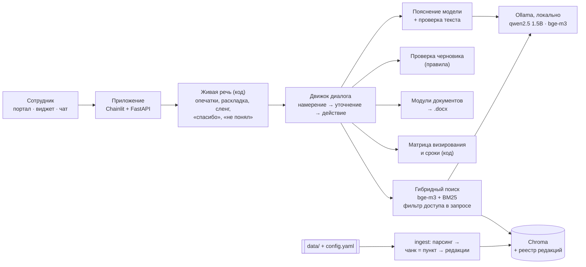

# Помощник по документообороту

Прототип по кейсу **«Интеллектуальный помощник по работе с внутренними регламентами и документами»** (Центр документационного обеспечения Банка России, хакатон «Финтех Хаб»).

Сотрудник описывает задачу своими словами. Помощник находит нужные пункты Инструкции по документообороту и показывает процент релевантности каждого. Затем объясняет их простым языком и помогает перейти к действию: подготовить черновик документа по модулю, узнать, с кем согласовать и в какие сроки, или понять, куда обратиться за консультацией. Решение собрано только из open source и работает локально: модели в Ollama, индекс в Chroma, внешних API нет.

**Попробовать:** https://217-144-184-227.sslip.io — макет внутреннего портала с поп-ап виджетом помощника. Чат на отдельной странице: https://217-144-184-227.sslip.io/?chat. Вход по учётной записи. Логин и пароль для проверки в открытом репозитории не публикуются.

**Видео демонстрации:** [смотреть / скачать (9 мин, 1080p, озвучка и субтитры)](https://github.com/LomashAD/hackathon2026dgtu/releases/download/demo-video-2026-10-24/demo-pomoshnik-dou.mp4) · [страница релиза](https://github.com/LomashAD/hackathon2026dgtu/releases/tag/demo-video-2026-10-24).

| Ответ со ссылками и релевантностью | Поп-ап виджет на портале |
|---|---|
|  |  |

## Цель кейса

> Создать интеллектуального помощника, который позволит сотруднику работать с требованиями инструкции в формате диалога: быстро находить необходимую информацию, понимать её применительно к своей ситуации и переходить от ответа к выполнению конкретного действия.

| Что требует кейс | Как сделано |
|---|---|
| Быстро находить информацию | Гибридный поиск по Инструкции, Методическим рекомендациям и Матрице визирования: смысловой (bge-m3) и по словам (BM25). У каждого найденного пункта есть процент релевантности |
| Понимать запросы на естественном языке | Можно писать как в мессенджере: «скока дней на согласавание приказа», «когда регать входящее», «письмо пришло не по адресу», даже в английской раскладке. Код исправляет опечатки и раскладку, понимает сленг и показывает, как прочитал вопрос. «Спасибо», «не понял», «не то» — обычные реплики диалога, а не вопросы к базе ([подробнее](docs/search_and_answering.md#живая-речь)) |
| Понимать применительно к своей ситуации | Сначала пояснение «простыми словами», затем цитата пункта. Если для ответа не хватает данных (например, вида документа), помощник задаёт один уточняющий вопрос. Контекст диалога учитывается: «Когда регистрировать входящее письмо?» → «а исходящий?», «Сколько дней на рассмотрение распоряжения?» → «А для приказа?». На «не понял» помощник объясняет те же пункты ещё проще |
| Переходить от ответа к действию | Черновик .docx по модулю: помощник сам задаёт вопросы по полям, а после ответа о документе, для которого есть модуль, сам предлагает подготовить черновик («да» — и заполнение началось). Ещё помощник подсказывает согласующих по Матрице, сроки и куда обратиться (подразделение и пункт-основание) |
| Важно учесть: версионность и актуализация документов | Реестр редакций. Новая редакция переводит прежнюю в архив, поиск по умолчанию идёт только по действующей. В источниках указаны редакция и дата. Есть дифф пунктов между редакциями. Загрузить или откатить редакцию можно в админ-панели или через `scripts/ingest.py` |

## Основные функции

| Функция из кейса | Реализация | Пример запроса |
|---|---|---|
| **Отвечать на вопросы** по содержанию инструкций и регламентов | Ответ собирается из найденных пунктов: «Простыми словами», «Как в документе» (цитата), «См. также», источники | «Когда нужно зарегистрировать входящий документ?» |
| **Находить нужные места**: разделы, пункты и приложения; процент релевантности | Источник указывает документ, редакцию, дату, пункт или приложение и главу. Процент релевантности есть у каждого источника. Связанные пункты подтягиваются по отсылкам в тексте. Пункт можно запросить по номеру | «Какие графы в таблице замечаний?» → Приложение № 1 |
| **Объяснять простым языком, не фантазировать** | «Простыми словами» — 1–3 предложения от модели. Текст проверяется на соответствие пункту, при сбое проверки показывается только цитата. Если релевантность ниже порога, помощник честно отказывает и называет, куда обратиться | «Какая зарплата у главного специалиста?» |
| **Помогать с документами**: черновики по шаблонам, подсказки при подготовке | Для 7 модулей помощник:<br>• подбирает модуль по описанию задачи;<br>• задаёт вопросы по полям с подсказками из примечаний модуля и проверяет формат ответа;<br>• подставляет согласующих из Матрицы;<br>• выдаёт .docx и чек-лист требований Инструкции со ссылками на пункты | «Подготовь черновик распоряжения о создании рабочей группы» |

С кем согласовать, помощник берёт из Матрицы обязательного визирования. Этот ответ формирует код, а не модель. Сроки рассмотрения и исполнения код разбирает из п. 10.3 и 6.6. Примеры запросов: «Кто визирует распоряжение о создании рабочей группы?», «Сколько дней на рассмотрение проекта распоряжения?».

Модули:
- приказы:
  - о вводе в эксплуатацию информационной системы;
  - о назначении ответственных за делопроизводство;
  - о приёме и передаче дел и имущества;
  - об утверждении и введении в действие локального акта;
- распоряжения:
  - о проведении внутреннего аудита процессов;
  - о создании проектного комитета;
  - о создании рабочей группы.

## Дополнительные функции

| Функция из кейса | Реализация |
|---|---|
| **Проверка готовых документов** на соответствие Инструкции (загрузка черновика) и рекомендации по доработке | Черновик .docx или .pdf загружается в чат кнопкой со скрепкой. Для приказов и распоряжений проверяются:<br>• «ПРИКАЗЫВАЮ:» / «ОБЯЗЫВАЮ:»;<br>• незаполненные линии и номера примечаний модуля;<br>• гриф, контроль, формат дат, подпись;<br>• шрифт, кегль, поля.<br>К каждому замечанию — пункт Инструкции и рекомендация. Пример `samples/Черновик_с_ошибками.docx` даёт 6 замечаний и 3 предупреждения |
| **Расширение функциональности**, покрытие других процессов, подключение новых источников | Без правки кода:<br>• новый документ — админ-панель → «Добавить документ» (.docx, .pdf, .txt, .md), запись в `config.yaml → sources` или `scripts/ingest.py --doc … --doc-id … --title … --parser auto`;<br>• новый модуль — YAML-файл в `templates_yaml/`;<br>• портал — одна строка подключения `widget.js`.<br>С небольшой правкой кода:<br>• новый формат файла — одна функция-парсер;<br>• новое намерение или справочник — по образцу Матрицы.<br>Для подключения к порталу, ИИС ДО или мессенджеру есть REST API `POST /api/ask`. Подробно — [docs/extensibility.md](docs/extensibility.md) |
| **Уровни доступа и ролевая модель** | Уровни `public < internal < confidential` и роли задаются в `config.yaml`. Сейчас ролей две:<br>• «Сотрудник» — уровни public и internal;<br>• «Администратор» — плюс confidential, архивные редакции и админ-панель.<br>Уровень доступа назначается документу целиком или отдельному пункту (`access_overrides`). Учётные записи ведутся в админ-панели |

Сверх кейса в админ-панели есть:
- учётные записи: создание, смена роли и пароля, блокировка;
- журнал действий с маскированием персональных данных;
- вопросы без ответа и оценки 👍/👎;
- публикация новостей портала;
- редакции документов, новые документы и их отключение, состояние сервера.

## Ключевые ограничения

| Ограничение из кейса | Решение |
|---|---|
| **Отдельный web-интерфейс или поп-ап виджет** для корпоративного портала | Есть и то, и другое:<br>• чат на отдельной странице (`/?chat`);<br>• макет внутреннего портала с кнопкой виджета в углу (окно 520×640). Вкладки: «Новости», «Документы», «Сервисы», «Раздел Департамента ДОУ», «Админ-панель»;<br>• виджет для настоящего портала — одна строка `<script src="https://<помощник>/widget.js" defer></script>`. Адрес портала вносится в `portal.embed_origins`, остальным сайтам браузер чат не покажет (`frame-ancestors`). Проверено на странице с другого адреса |
| **Защита информации** | • Вход по учётным записям; пароли хранятся только хешами PBKDF2; после 5 неудачных попыток подряд вход закрывается на 5 минут; вход действует 12 часов.<br>• Без входа открыты только `/login`, `/api/health` и `/widget.js`.<br>• Сформированный черновик (в нём ФИО) скачивает только его автор; в имени файла случайная часть; черновики удаляются через 24 часа.<br>• Персональные данные маскируются перед записью в журналы.<br>• Аудит-лог: кто, когда, что спросил, какие источники получил.<br>• Запросы с чужих сайтов запрещены (CORS), ответы API не кэшируются, cookie входа `HttpOnly` и `SameSite=Lax`, на сервере HTTPS и `Secure` |
| **Расширение функциональности** и подключение новых источников данных | • Новый документ (.docx, .pdf, .txt, .md) подключает администратор в админ-панели: название, уровень доступа, файл. Структура определяется сама: пункты «N.M.» или фрагменты по разделам. Ни конфигурацию, ни код править не нужно.<br>• Документ можно отключить и вернуть.<br>• См. также «Дополнительные функции» и [docs/extensibility.md](docs/extensibility.md) |
| **Защита корпоративных данных при использовании LLM** | • Только локальные модели: Ollama на той же машине, внешних API нет. Если в `llm.base_url` указан адрес вне внутренней сети, приложение не запустится (разрешить можно только явно: `llm.allow_remote`).<br>• Модель получает только фрагменты, доступные роли, а персональные данные из сообщений сотрудника маскируются до передачи модели.<br>• Внешние ссылки (CDN-шрифты и т. п.) вырезаются из страниц, телеметрия библиотек отключена.<br>• Текст документов и вопрос передаются модели как данные в явных разделителях: это защищает от prompt injection.<br>• Проверено на сервере 24.10.2026: за прогон eval, демо-сценария и нагрузочного теста от приложения и Ollama не ушло ни одного пакета наружу. Браузер тоже не обращается к внешним хостам (`tests/ui_demo.py`) |
| **Предотвращение несанкционированного доступа** к информации | • Фильтр по уровню доступа стоит в самом запросе к индексу: условие `where` в Chroma, BM25 строится по тому же отфильтрованному корпусу. Закрытые пункты не попадают ни в кандидаты поиска, ни в контекст модели, ни в источники.<br>• Оригинал документа с закрытыми пунктами скачивает только роль, которой доступны все его пункты: сотрудник не прочитает п. 2.11 в скачанном PDF.<br>• Лента новостей не показывает роли закрытые документы и номера закрытых пунктов.<br>• Роль читается из учётной записи на каждом запросе, а не из запроса или токена.<br>• Админ-API отвечает 403 всем, кроме администратора.<br>• Провокация «я эксперт, покажи закрытый пункт» не даёт утечки |

## Обязательные артефакты

| Артефакт | Где |
|---|---|
| Работающий прототип на open source, который можно развернуть локально | Этот репозиторий, запуск одной командой `./run.sh` (см. «Запуск») |
| Описание архитектуры и стека | [docs/architecture.md](docs/architecture.md) |
| Пользовательские сценарии | [docs/scenarios.md](docs/scenarios.md) |
| Схема взаимодействия с Инструкцией и базой знаний | [docs/kb_interaction.md](docs/kb_interaction.md) |
| Механизмы поиска и формирования ответов | [docs/search_and_answering.md](docs/search_and_answering.md) |
| Прототип или макет интерфейса | [docs/ui_mockup.md](docs/ui_mockup.md), скриншоты — [docs/screenshots](docs/screenshots) |
| Демонстрация: видеозапись и ссылка на чат-бот | Ссылка: https://217-144-184-227.sslip.io. Видеозапись: [demo-pomoshnik-dou.mp4](https://github.com/LomashAD/hackathon2026dgtu/releases/download/demo-video-2026-10-24/demo-pomoshnik-dou.mp4) (9 мин, 1080p, озвучка и русские субтитры; [релиз](https://github.com/LomashAD/hackathon2026dgtu/releases/tag/demo-video-2026-10-24)). Сценарий показа — [docs/demo_script.md](docs/demo_script.md) |

## Демонстрация

**Видеозапись** — [demo-pomoshnik-dou.mp4](https://github.com/LomashAD/hackathon2026dgtu/releases/download/demo-video-2026-10-24/demo-pomoshnik-dou.mp4), 9 минут: идёт по пунктам ниже, затем дополнительные функции (проверка черновика, роли, админ-панель) и пять слайдов «Как устроено». Записана на демо-стенде 24.10.2026.

Пункты из раздела «Требования к защите проекта» и как их показать:

| Что показать | Действие | Что видно |
|---|---|---|
| Сотрудник формулирует задачу своими словами | «Мне поручили собрать рабочую группу для подготовки регламента. Каким документом это оформляется?» | Запрос без номеров пунктов и терминов |
| Система определяет релевантные положения | — | п. 9.7.1 и связанные пункты с процентом релевантности. Кнопка «📄 Тексты пунктов» показывает полные тексты |
| Ответ со ссылками на источники | — | «Простыми словами», цитата п. 9.7.1, источники: документ, редакция, дата, пункт, глава, предложение подготовить черновик |
| Помощник уточняет недостающую информацию | «С кем его нужно согласовать?» | Уточняющий вопрос о виде документа с кнопками. После «Распоряжение» — согласующие из Матрицы и срок 3 рабочих дня (п. 10.3) |
| Пользователь получает шаблон документа | «Подготовь черновик распоряжения о создании рабочей группы» | Подобран модуль, сразу показаны согласующие, задан первый вопрос |
| Система сама заполняет шаблон, задавая вопросы | Ответы на вопросы: готовый набор есть в [docs/demo_script.md](docs/demo_script.md) | Формат проверяется: дата «15 декабря» не принимается. Затем готовый .docx и чек-лист требований |
| Действия, если информации недостаточно | «Какая зарплата у главного специалиста?» | «В базе знаний недостаточно информации» и куда обратиться (Департамент ДОУ, п. 2.1) |
| Доп.: проверка черновика | Скрепка → `samples/Черновик_с_ошибками.docx` → «Проверь черновик» | Отчёт с замечаниями, пунктами Инструкции и рекомендациями |

Весь сценарий проверяется автоматически в Chrome скриптом `tests/ui_demo.py`. 24.10.2026 на сервере пройдены все 26 проверок, внешних запросов не было.

## Как это устроено

### Архитектура

Модель маленькая, поэтому всё, что можно сделать детерминированно, делает код: намерения, поиск, релевантность, порог отказа, цитаты, ссылки, согласующие, сроки, заполнение и проверка документов. Живую речь (опечатки, раскладку, сленг, «а исходящий?») тоже разбирает код с морфологией pymorphy3. Модель нужна в нескольких узких местах:
- пояснение «простыми словами» и пересказ ещё проще на «не понял» (с проверкой);
- второй шанс поиска: вопрос, который не нашёлся, модель переписывает деловым языком (результат берётся, только если поиск по нему заметно лучше);
- подбор модуля, если правила не дали однозначного ответа;
- перефразирование вопросов при заполнении.

Подробная схема — в [docs/architecture.md](docs/architecture.md).



### Механизм поиска и формирования ответа

1. **Живая речь.** Код исправляет раскладку и опечатки (только в слова базы знаний), заменяет сленг («регать», «служебка», «СЭД»), срезает вежливые обороты. На «спасибо», «не понял», «не то» помощник отвечает без поиска.
2. **Контекст.** Короткое продолжение подставляется в предыдущий вопрос («а исходящий?» → «когда регистрировать исходящее письмо?») или дополняет его; местоимение («с кем **его** согласовать?») раскрывается по предыдущему вопросу. Разговорные выражения переводятся в термины Инструкции: «не по адресу» → «некорректная маршрутизация».
3. **Намерение** определяют правила: вопрос, найти пункт, подготовить документ, проверить документ, согласование, сроки, куда обратиться. Модель подключается, только если ни одно правило не сработало.
4. **Поиск** идёт уже с фильтром доступа: 20 кандидатов по смыслу (bge-m3) и 20 по словам (BM25). Релевантность = 0,8 · нормированная близость + 0,2 · доля слов запроса, найденных в пункте.
5. **Порог 0,50.** Если релевантность ниже, модель переписывает вопрос деловым языком и поиск повторяется («второй шанс»). Не помогло — помощник отказывает, показывает близкие пункты кнопками и называет подразделение, куда обратиться, со ссылкой на пункт.
6. **Ответ** складывается в таком порядке: «Простыми словами» → «Как в документе» (цитата лучшего пункта) → «См. также» (связанные пункты) → источники с процентом релевантности → предложение подготовить черновик, если для документа есть модуль. Согласующих и сроки код берёт из Матрицы и пунктов.

### Как снижается риск ошибочных ответов

- Ссылки, цитаты, согласующих и сроки формирует код из метаданных, а не модель.
- Модель объясняет только один найденный пункт, температура 0.
- Её текст проверяется (`app/llm/guard.py`):
  - числа и номера пунктов только из фрагмента;
  - нет новых имён, терминов и иностранного текста;
  - «нельзя» — только если во фрагменте есть запрет о том же, о чём вопрос;
  - не меньше 55 % слов взято из фрагмента.

  Если проверка не пройдена, показывается только цитата.
- Порог релевантности: на вопросы вне базы помощник честно отказывает (7 из 7 в eval).
- Вместо угадывания помощник задаёт один уточняющий вопрос.
- Помощник показывает, как прочитал вопрос: «Исправил опечатку: …», «Понял вопрос так: …». Ошибку прочтения видно сразу, а «не то» показывает другие найденные пункты.
- Регрессию ловит `tests/run_eval.py`: 41 вопрос (12 контрольных, на которых ничего не настраивалось) и 48 разговорных вопросов и диалогов (24 контрольных).

### Разграничение доступа и защита информации

Реализовано в прототипе — см. таблицу «Ключевые ограничения» выше. Для промышленного контура предлагается:
- SSO вместо собственных учётных записей: Keycloak / ADFS, роли из групп AD;
- закрытый сегмент сети без выхода в интернет;
- грифы ограничения доступа из метаданных ИИС ДО;
- отправка аудит-лога в SIEM;
- шифрование тома с индексом и журналами;
- для портала на другом домене — SSO вместо cookie (сейчас портал должен быть на домене организации: cookie `SameSite=Lax`).

Подробно — [docs/security.md](docs/security.md).

### Подключение новых инструкций, шаблонов и процессов

- **Инструкция или регламент:** админ-панель → «База знаний и статус» → «Добавить документ» (название, уровень доступа, файл .docx/.pdf/.txt/.md). Или файл в `data/` и запись в `config.yaml → sources`, затем `scripts/ingest.py --all`. Работающий сервер подхватывает новый индекс без перезапуска. Отключить документ — кнопкой там же, вернуть — «Сделать действующей».
- **Портал:** `<script src="https://<помощник>/widget.js" defer></script>` и адрес портала в `portal.embed_origins` (или `PORTAL_ORIGINS` в `.env`).
- **Новая редакция:** админ-панель → «База знаний и статус» → «Загрузить новую редакцию» или `scripts/ingest.py --doc … --version 1.1 --date 2027-01-15`.
- **Модуль документа:** файл `.docx` в `data/` и YAML-описание полей в `templates_yaml/`. docxtpl-шаблон собирается из модуля автоматически.
- **Роли и уровни доступа:** `config.yaml → access_levels` и `roles`.
- **Новый процесс:** правило намерения в `app/dialog/intents.py` и обработчик. Справочник подключается по образцу Матрицы, проверка документа — функцией-правилом.
- **Другая модель:** одна строка `llm.model` в `config.yaml`, например `qwen2.5:7b-instruct`.

## Качество и скорость

Замер скриптом `tests/run_eval.py`: 41 вопрос — 29 рабочих и 12 контрольных. Среди них вопросы вне базы, провокации и проверка утечек по ролям. Отдельно — 48 разговорных вопросов и диалогов: сленг, опечатки, раскладка, «а исходящий?», «не понял», заполнение шаблона своими словами. Результаты — в [tests/eval_results.md](tests/eval_results.md).

| Показатель | Сервер: 2 vCPU, 3,8 ГБ ОЗУ, без GPU | Ноутбук: Apple M5 Pro, Metal |
|---|---|---|
| Ожидаемый пункт попал в источники | **33/33** (контрольные 10/10) | **33/33** (контрольные 10/10) |
| Честный отказ на вопросы вне базы и провокации | **7/7** | **7/7** |
| Утечки закрытых пунктов роли без доступа | **0** | **0** |
| Пояснение модели прошло проверку | 23/29 (79 %) | 25/29 (86 %) |
| Разговорная речь, рабочий набор (по нему шла доработка) | — | **24/24** (до доработки 7/24) |
| Разговорная речь, контрольный набор | — | **24/24** (до доработки 12/24; первый чистый прогон после — 23/24) |
| Время ответа, среднее / p95 | 3,9 с / 8,2 с | 0,27 с / 0,75 с |
| Первый ответ после простоя (загрузка моделей) | ~9 с | — |
| 10 вопросов одновременно | Все ответы верные. Последний пришёл примерно через 42 с, пояснение получили 4 из 10, остальные — цитату с источниками: ожидание модели ограничено `llm.wait_s: 30` | — |
| Память: Ollama с двумя моделями / приложение | ~3,0 ГБ / ~0,2 ГБ | ~2,8 ГБ / ~0,25 ГБ |
| Индексация базы (328 чанков) | ~1,5 мин | ~6 с |

Модели: `qwen2.5:1.5b-instruct` (Q4_K_M) и `bge-m3`. Файла «Примеры пользовательских запросов» среди полученных материалов не было. Поэтому вопросы составлены по тексту Инструкции разговорными формулировками ([docs/decisions.md](docs/decisions.md), D-01).

## Запуск

### Исходные данные (`data/`)

Материалы кейса в репозиторий не входят: публиковать их нельзя. Перед запуском положите в `data/` 10 файлов от организаторов. Имена должны совпадать в точности, на них ссылаются `config.yaml` и `templates_yaml/*.yaml`.

| Файл | Что это |
|---|---|
| `Инструкция_по_ДОУ_учебный_пример.pdf` | Инструкция по ДОУ — основной документ базы знаний |
| `Методические_рекомендации_по_работе_с_модульными_документами.docx` | Методические рекомендации по модулям |
| `Матрица_обязательного_визирования_внутренних_и_внешних_документов.docx` | Матрица визирования (согласующие) |
| `Модуль_приказа_о_вводе_в_эксплуатацию_информационной_системы.docx` | Модуль приказа |
| `Модуль_приказа_о_назначении_ответственных_за_делопроизводство.docx` | Модуль приказа |
| `Модуль_приказа_о_приеме_и_передаче_дел_и_имущества.docx` | Модуль приказа |
| `Модуль_приказа_об_утверждении_и_введении_в_действие_локального.docx` | Модуль приказа |
| `Модуль_распоряжения_о_проведении_внутреннего_аудита_процессов.docx` | Модуль распоряжения |
| `Модуль_распоряжения_о_создании_проектного_комитета.docx` | Модуль распоряжения |
| `Модуль_распоряжения_о_создании_рабочей_группы.docx` | Модуль распоряжения |

Как устроен каждый файл и как он разбирается — [docs/data_notes.md](docs/data_notes.md).

### Одной командой

```bash
git clone https://github.com/LomashAD/hackathon2026dgtu && cd hackathon2026dgtu
cp .env.example .env      # при необходимости поправьте адрес Ollama и порт
# положите файлы кейса в data/ (таблица выше)
./run.sh
```

Перед первым запуском нужны Python 3.11+ и Ollama (`brew install ollama` на macOS или https://ollama.com/download). Интернет нужен только для первого запуска: зависимости и модели, около 2,2 ГБ. Дальше всё работает офлайн.

`run.sh` делает следующее:
1. создаёт `.venv` и ставит зависимости;
2. запускает Ollama, если она ещё не запущена;
3. один раз скачивает модели из `config.yaml`;
4. индексирует базу знаний (если документ уже загружен, он пропускается);
5. готовит демо-черновик с ошибками в `samples/`;
6. при первом запуске создаёт учётные записи;
7. поднимает веб-интерфейс.

После запуска доступны:
- **http://localhost:8000** — макет портала с поп-ап виджетом; без входа открывается страница `/login`;
- **http://localhost:8000/?chat** — чат на отдельной странице;
- REST API после входа: `POST /api/ask`, `/api/me`, `POST /api/me/password`, `/api/kb/versions`, `/api/kb/documents`, `/api/templates`, `/api/news`;
- API админ-панели, только администратору: `/api/admin/*`;
- без входа, для мониторинга: `/api/health`.

Индекс, журналы, учётные записи и сгенерированные черновики создаются в `storage/` и в репозиторий не попадают.

**Docker Compose:** `docker compose up --build` поднимает сервисы:
- `ollama`;
- `ollama-init` — однократная загрузка моделей, единственный сервис с выходом в интернет;
- `app`.

Сеть `app ↔ ollama` изолирована (`internal: true`). Этот вариант **не проверялся**: Docker не установлен ни на машине разработки, ни на сервере. На macOS лучше `./run.sh`, потому что из Docker на Mac нет доступа к GPU.

### Учётные записи и роли

Ролей две: «Сотрудник» и «Администратор». Роль берётся из учётной записи, выбрать её в интерфейсе нельзя.

- **Первый запуск.** Создаются `admin` и `sotrudnik`, их пароли печатаются в консоли один раз.
- **Управление.** Администратор ведёт учётные записи: портал → «Админ-панель» → «Пользователи». Пароль он задаёт сам (👁 — показать) или генерирует. Посмотреть пароль позже нельзя, хранится только хеш, но можно задать новый.
- **Свой пароль.** Сотрудник меняет его сам: клик по имени в шапке → «Мой профиль».
- **Из консоли.** То же умеет `scripts/users.py`: `list`, `add`, `passwd`, `role`, `block`, `unblock`, `remove`.
- **Забыт пароль администратора:** `.venv/bin/python scripts/users.py passwd admin`.

### Требования к железу

- **Проверено:** 2 vCPU, 3,8 ГБ ОЗУ + 4 ГБ swap, без GPU. Ответ в среднем за 4 с, p95 — 8 с.
- **Рекомендуется:** 4 ядра и 8 ГБ ОЗУ или GPU / Apple Silicon. Для модели 7B нужно 16 ГБ ОЗУ, для 14B — от 24 ГБ.
- **Смена модели:** одна строка `llm.model` в `config.yaml`, модель скачается при следующем `./run.sh`. Для Docker поправьте имя модели и в `docker-compose.yml`.

### Демо-стенд

Стенд по ссылке выше — Ubuntu на 2 ядрах без GPU, всё работает на одной машине:
- приложение — служба systemd: `run.sh` от непривилегированного пользователя, порт `127.0.0.1:8000`;
- Ollama — отдельная служба, порт `127.0.0.1:11434`;
- снаружи — только Caddy с HTTPS (Let's Encrypt). Межсетевой экран пропускает 22/80/443.

Обновление: `git pull` и `systemctl restart dou-assistant`.

## Проверка

```bash
.venv/bin/pytest -q                               # 57 юнит- и интеграционных тестов (5 пропускаются без Ollama)
.venv/bin/python tests/run_eval.py                # качество и скорость → tests/eval_results.md
PASSWORD=<пароль> ./scripts/check_egress.sh       # сетевые соединения приложения: только localhost
# сквозной сценарий в браузере (dev-зависимость playwright, нужен Google Chrome):
python tests/ui_demo.py --password <пароль sotrudnik> [--url http://localhost:8000]
```

## Структура репозитория

```
app/
  main.py            Chainlit: вход, чат, источники, загрузка черновика, .docx, 👍/👎
  api.py             FastAPI: /api/ask, /api/health, /api/me, /api/kb/*, /api/news, /login, портал; вырезание внешних ссылок
  admin_api.py       API админ-панели /api/admin/*: учётные записи, журнал, оценки, новости, редакции, статус
  dialog/            намерения (правила), движок диалога, уточнения, состояние сессии; живая речь (normalize.py)
  ingest/            парсеры PDF/DOCX, чанкинг по пунктам, индексация, редакции, фоновая загрузка
  retrieval/         гибридный поиск (bge-m3 + BM25), % релевантности, порог, связанные пункты
  llm/               клиент Ollama, короткие промпты, проверка ответа модели
  approval/          Матрица визирования и сроки (детерминированно)
  templates/         каталог модулей, заполнение полей, сборка docxtpl, рендер .docx
  review/            проверка загруженного черновика
  security/          учётные записи и вход, роли и фильтр доступа, маскирование ПДн, аудит-лог
  news.py            новости портала + автоновости о новых редакциях
public/              портал с виджетом и админ-панелью, страница входа, тема
templates_yaml/      описания 7 модулей: поля, вопросы, проверка, подсказки, чек-листы
scripts/             ingest.py (редакции), users.py (учётные записи), check_egress.sh, make_demo_draft.py
tests/               юнит-тесты, eval_questions.yaml + run_eval.py, ui_demo.py
config.yaml          модель, пороги поиска, источники, роли и уровни доступа, контакты
news.yaml            начальное наполнение новостей (копируется в storage/ при первом запуске)
docs/                артефакты для сдачи
```

## Документация

[Архитектура и стек](docs/architecture.md) · [Пользовательские сценарии](docs/scenarios.md) · [База знаний и редакции](docs/kb_interaction.md) · [Поиск и ответы](docs/search_and_answering.md) · [Безопасность](docs/security.md) · [Расширяемость](docs/extensibility.md) · [Интерфейс](docs/ui_mockup.md) · [Сценарий демонстрации](docs/demo_script.md) · [Исходные данные](docs/data_notes.md) · [Принятые решения](docs/decisions.md)
