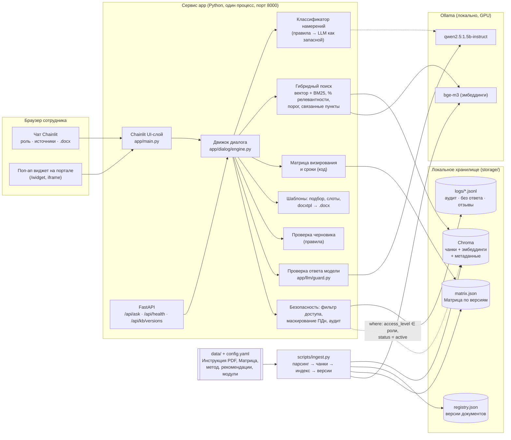

# Архитектура и стек

## Принцип

Модель маленькая (`qwen2.5:1.5b-instruct`), поэтому **всё, что можно сделать детерминированно, делает код**: классификация намерений, поиск, оценка релевантности, порог отказа, цитаты, ссылки на источники, согласующие по Матрице, сроки, заполнение шаблонов, проверка документов. LLM используется в трёх узких местах: короткое пояснение «простыми словами» (с проверкой на соответствие фрагменту), подбор шаблона, если правила не дали однозначного ответа, и перефразирование вопросов при заполнении шаблона. Модель задаётся в `config.yaml` и меняется на 7B/14B одной строкой.

## Схема

## Компоненты

| Модуль | Назначение | Технологии |
|---|---|---|
| `app/main.py` | Веб-интерфейс: профили-роли, кнопки быстрых ответов и уточнений, источники в боковой панели, загрузка черновика, скачивание .docx, 👍/👎 | Chainlit 2.12 |
| `app/api.py` | REST API ядра, страница-макет портала с виджетом, middleware, вырезающий внешние CDN-ссылки | FastAPI |
| `app/dialog/` | Намерения (вопрос, найти пункт, создать документ, проверить документ, согласование, сроки, куда обратиться). Состояние сессии: роль, история, выбранные параметры, ожидаемое уточнение, заполняемый шаблон | Python, regex |
| `app/ingest/` | Парсинг PDF (с фильтром водяного знака) и DOCX, чанкинг по пунктам, извлечение отсылок `refs`, индексация, реестр версий, дифф пунктов | pdfplumber, python-docx, Chroma |
| `app/retrieval/` | Гибридный поиск: косинус bge-m3 + BM25, калиброванный %, порог, подтягивание связанных пунктов | Chroma, собственный BM25 |
| `app/llm/` | Клиент Ollama, короткие промпты с одним примером, проверка ответа модели | httpx, Ollama |
| `app/approval/` | Матрица визирования (строка, согласующие, условия), сроки по п. 10.3 и 6.6 | JSON |
| `app/templates/` | YAML-каталог шаблонов, подбор, вопросы и валидация полей, сборка docxtpl-шаблона из исходного модуля, рендер | docxtpl, Jinja2 |
| `app/review/` | Проверка загруженного .docx/.pdf: реквизиты, служебные элементы модуля, оформление | python-docx, pdfplumber |
| `app/security/` | Роли и уровни доступа, условие `where` для индекса, маскирование ПДн, аудит-лог | — |

## Стек

Python 3.12, FastAPI, Chainlit, Ollama (`qwen2.5:1.5b-instruct`, `bge-m3`), Chroma (персистентный), собственный BM25, pdfplumber, python-docx, docxtpl, PyYAML. Все компоненты open source. Запуск: `./run.sh` (нативная Ollama с GPU) или `docker compose up` (сервисы `app` и `ollama`).

## Поток обработки сообщения

1. `engine.handle()` обрезает сообщение до лимита. Если идёт заполнение шаблона, ответ уходит в валидацию поля. Если ждём ответа на уточнение, ответ разрешается в параметр.
2. Классификатор правил определяет намерение. LLM спрашивается только если ни одно правило не сработало.
3. Дальше маршрут по намерению:
   - **вопрос / найти пункт** — переформулировка с учётом истории, гибридный поиск с фильтром доступа в `where`, порог, цитата лучшего пункта, пояснение модели с проверкой, источники;
   - **согласование** — вид документа и строка Матрицы (при нехватке — один уточняющий вопрос), согласующие, срок по п. 10.3, порядок визирования по п. 10.6;
   - **сроки** — вид документа (или уточнение) и срок из п. 10.3 / 6.6;
   - **создать документ** — подбор шаблона (правила, затем LLM, затем выбор кнопкой), вопросы по полям, .docx, чек-лист, согласующие;
   - **проверить документ** — отчёт правил;
   - **куда обратиться** — подразделение и пункт-основание.
4. Аудит-запись: пользователь, роль, сессия, намерение, маскированный запрос, источники, отказ, время.
