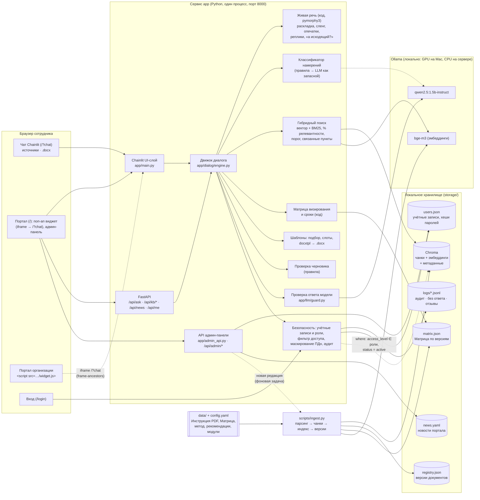
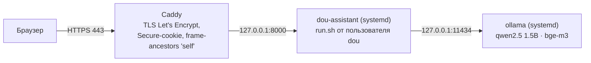

# Архитектура и стек

## Принцип

Модель маленькая (`qwen2.5:1.5b-instruct`), поэтому **всё, что можно сделать детерминированно, делает код**: классификация намерений, поиск, оценка релевантности, порог отказа, цитаты, ссылки на источники, согласующие по Матрице, сроки, заполнение шаблонов, проверка документов. LLM используется в трёх узких местах: короткое пояснение «простыми словами» (с проверкой на соответствие фрагменту), подбор шаблона, если правила не дали однозначного ответа, и перефразирование вопросов при заполнении шаблона. Модель задаётся в `config.yaml` и меняется на 7B/14B одной строкой.

## Схема

## Компоненты

| Модуль | Назначение | Технологии |
|---|---|---|
| `app/main.py` | Веб-интерфейс чата: вход по учётной записи (роль берётся из неё), кнопки быстрых ответов и уточнений, источники в боковой панели, загрузка черновика, скачивание .docx, 👍/👎, поиск по архиву для администратора | Chainlit 2.12 |
| `app/api.py` | REST API ядра (`/api/ask`, `/api/kb/*`, `/api/news`, `/api/me`), страницы входа и портала, middleware, вырезающий внешние CDN-ссылки | FastAPI |
| `app/admin_api.py` | API админ-панели, только администратору: учётные записи, журнал действий, вопросы без ответа и оценки, новости, загрузка и смена редакций, статус системы | FastAPI |
| `app/news.py` | Лента новостей портала: `storage/news.yaml` и автоматические новости о новых редакциях из реестра версий | PyYAML |
| `public/` | Портал с поп-ап виджетом и админ-панелью (`portal_widget.html`), виджет для портала организации одной строкой (`widget.js`, Shadow DOM), страница входа, тема портала и чата (`theme.js`) | HTML, JS |
| `app/dialog/` | Намерения (вопрос, найти пункт, создать документ, проверить документ, согласование, сроки, куда обратиться). Состояние сессии: роль, история, выбранные параметры, ожидаемое уточнение, заполняемый шаблон, предложенное действие, пункты последнего ответа. `normalize.py` — живая речь: раскладка, сленг, опечатки по словарю базы знаний, вежливые обороты, виды реплик, подстановка уточнения в прошлый вопрос, разговорные выражения → термины ([search_and_answering.md](search_and_answering.md#живая-речь)) | Python, regex, pymorphy3 |
| `app/ingest/` | Парсинг PDF (с фильтром водяного знака) и DOCX, произвольных .docx/.pdf/.txt/.md (`plain`, `auto`), чанкинг по пунктам, извлечение отсылок `refs`, индексация, реестр версий, дифф пунктов, фоновая загрузка редакции из админ-панели (`jobs.py`) | pdfplumber, python-docx, Chroma |
| `app/retrieval/` | Гибридный поиск: косинус bge-m3 + BM25, калиброванный %, порог, подтягивание связанных пунктов | Chroma, собственный BM25 |
| `app/llm/` | Клиент Ollama (только адрес во внутренней сети), короткие промпты с одним примером, маскирование ПДн сотрудника до передачи модели, проверка ответа модели | httpx, Ollama |
| `app/approval/` | Матрица визирования (строка, согласующие, условия), сроки по п. 10.3 и 6.6 | JSON |
| `app/templates/` | YAML-каталог шаблонов, подбор, вопросы и валидация полей, сборка docxtpl-шаблона из исходного модуля, рендер | docxtpl, Jinja2 |
| `app/review/` | Проверка загруженного .docx/.pdf: реквизиты, служебные элементы модуля, оформление | python-docx, pdfplumber |
| `app/security/` | Учётные записи и вход (хеши PBKDF2, блокировка после неудачных попыток, роль из учётной записи на каждом запросе), уровни доступа, условие `where` для индекса, маскирование ПДн, аудит-лог | — |

## Стек

Python 3.12, FastAPI, Chainlit, Ollama (`qwen2.5:1.5b-instruct`, `bge-m3`), Chroma (персистентный), собственный BM25, pymorphy3 (морфология для живой речи), pdfplumber, python-docx, docxtpl, PyYAML. Все компоненты open source. Запуск: `./run.sh` (нативная Ollama, на Mac с GPU). `docker-compose.yml` (сервисы `app` и `ollama`) написан, но не проверялся: Docker нет ни на машине разработки, ни на сервере.

## Развёртывание демо-стенда

Одна машина Ubuntu, 2 vCPU, без GPU (https://217-144-184-227.sslip.io):

Межсетевой экран пропускает только 22/80/443. Приложение и Ollama слушают только локальный адрес. Исходящих соединений у них нет ([security.md](security.md)).

## Поток обработки сообщения

1. `engine.handle()` обрезает сообщение до лимита. Если идёт заполнение шаблона, ответ уходит в валидацию поля («не знаю», «пример», «спасибо» и вопросы по ходу заполнения обрабатываются отдельно). Если ждём ответа на уточнение, ответ разрешается в параметр. «Да» после предложения черновика запускает заполнение.
2. Нормализация живой речи: раскладка, сленг, опечатки, вежливые обороты. Реплика без вопроса («спасибо», «не понял», «не то») получает ответ без поиска.
3. Классификатор правил определяет намерение. LLM спрашивается только если ни одно правило не сработало и в сообщении есть слова намерения. Уточнение вида «а распоряжение?» продолжает прошлую тему (Матрица, сроки).
4. Дальше маршрут по намерению:
   - **вопрос / найти пункт** — переформулировка с учётом истории, разговорные выражения → термины, гибридный поиск с фильтром доступа в `where`, порог, второй шанс поиска (модель переписывает вопрос), пояснение модели с проверкой, цитата, источники, предложение черновика;
   - **согласование** — вид документа и строка Матрицы (при нехватке — один уточняющий вопрос), согласующие, срок по п. 10.3, порядок визирования по п. 10.6;
   - **сроки** — вид документа (или уточнение) и срок из п. 10.3 / 6.6;
   - **создать документ** — подбор шаблона (правила, затем LLM, затем выбор кнопкой), вопросы по полям, .docx, чек-лист, согласующие;
   - **проверить документ** — отчёт правил;
   - **куда обратиться** — подразделение и пункт-основание.
5. Аудит-запись: пользователь, роль, сессия, намерение, маскированный запрос, источники, отказ, время.
