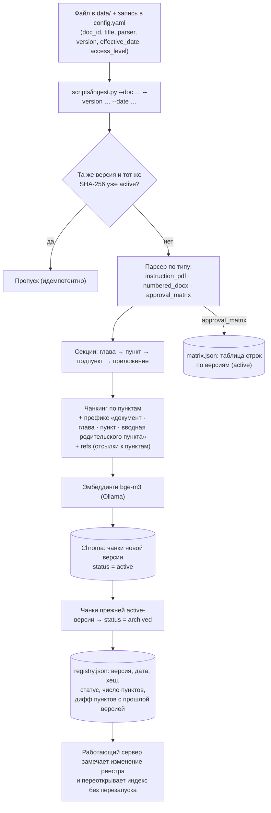

# Взаимодействие с Инструкцией и базой знаний

## Жизненный цикл документа в базе знаний

## Парсинг Инструкции (PDF)

- Водяной знак «УЧЕБНЫЙ ПРИМЕР…» набран повёрнутыми символами и отбрасывается по матрице символа.
- Глава определяется жирной строкой «Глава N. …» (с переносом названия), пункт — строкой «N.M. …», подпункт — «N.M.K. …». Номер принимается, только если он больше предыдущего (защита от ложных совпадений).
- Абзацы и элементы списков восстанавливаются по отступу первой строки и маркеру «•». Переносы слов через дефис склеиваются.
- Результат: 12 глав, 184 пункта, 69 подпунктов, Приложение № 1. Выборка из 10 пунктов сверена с оригиналом (`tests/test_core.py`).

## Метаданные чанка

| Поле | Пример | Назначение |
|---|---|---|
| `doc_id`, `doc_title`, `short_title` | `instr_dou`, «Инструкция по ДОУ» | ссылка на источник |
| `version`, `effective_date`, `status` | `1.0`, `2026-11-01`, `active` | версионность; поиск по умолчанию только по `active` |
| `section_path`, `chapter`, `heading`, `appendix` | `8.12.4`, `8`, «Требования к составу…», `` | ссылка на пункт и главу |
| `access_level` | `internal` / `confidential` | фильтр доступа в запросе к индексу |
| `refs` | `4.1.1,4.1.2,4.1.3` | подтягивание связанных пунктов |
| `part`, `parts` | `0`, `1` | части длинного пункта |
| `search_text` | «Инструкция по ДОУ. Глава 8. … п. 8.12.4. (К п. 8.12: Адресат располагается…) …» | текст для эмбеддинга и BM25 с заголовками |

## Матрица визирования

Матрица загружается **в таблицу** (`storage/matrix.json`, с версиями), а не в векторы: для каждой строки — группа (внутренние/внешние), вид документа, отметки «Да/Нет/При условии» по столбцам и условия. Ответы «с кем согласовать» строятся из таблицы кодом. Текстовое представление строк дополнительно индексируется, чтобы общий поиск тоже мог на них сослаться.

## Обновление и актуализация

- **Новая редакция:** `python scripts/ingest.py --doc data/<файл> --version 1.1 --date 2027-01-15`. Прежняя редакция переводится в `archived` и остаётся в индексе для истории. В ответе печатается дифф: добавленные, удалённые и изменённые пункты.
- **Откат:** повторный ingest прежней версии делает её `active`, текущая уходит в архив.
- **Просмотр:** `python scripts/ingest.py --list` или `GET /api/kb/versions`.
- **Архивные редакции в поиске:** роль `admin` может включить в настройках чата поиск по архиву. Такие источники помечаются «[АРХИВНАЯ РЕДАКЦИЯ]».
- **Новый документ:** `--doc-id … --title … --parser numbered_docx|instruction_pdf|approval_matrix` или запись в `config.yaml → sources` и `ingest.py --all`.
- Каждый ответ ссылается на редакцию и дату вступления в силу. Это соответствует п. 12.10 Инструкции: копия без возможности проверить актуальность не используется для принятия решения.
