# Поиск и формирование ответов

## Пайплайн

```mermaid
flowchart LR
  Q["Сообщение"] --> N["Нормализация (код, pymorphy3):<br/>раскладка, сленг, опечатки<br/>по словарю базы, вежливые обороты"]
  N --> ST{"Реплика без вопроса?<br/>«спасибо», «не понял», «не то»"}
  ST -- да --> SR["Ответ без поиска:<br/>вежливо, проще, другие пункты"]
  ST -- нет --> RW["Учёт истории (код):<br/>«а исходящий?» → подстановка<br/>в прошлый вопрос, «а если…» → дополнение"]
  RW --> X["Разговорные выражения → термины<br/>(colloquial_terms в config.yaml)"]
  X --> F["Фильтр where:<br/>access_level ∈ роль, status = active"]
  F --> V["Вектор: bge-m3, top-20<br/>(Chroma с where)"]
  F --> B["BM25 по тому же<br/>отфильтрованному корпусу, top-20"]
  V --> U["Объединение кандидатов"]
  B --> U
  U --> R["Релевантность, %<br/>0,8·норм(cos) + 0,2·покрытие терминов"]
  R --> T{"Лучший ≥ порога 0,50?"}
  T -- нет --> SC["Второй шанс: модель переписывает<br/>вопрос деловым языком → поиск ещё раз"]
  SC -- "не лучше" --> NO["«В базе знаний недостаточно информации»<br/>+ близкие пункты кнопками + куда обратиться"]
  SC -- "лучше на ≥ 5 п.п." --> K
  T -- да --> K["top-k (≤4, не хуже лучшего − 20 п.п.)<br/>+ связанные пункты по refs (≤2)"]
  K --> A["Ответ: «Простыми словами» (модель, с проверкой)<br/>→ «Как в документе» (цитата)<br/>→ «См. также» → источники с %<br/>→ предложение черновика, если есть модуль"]
```

## Оценка релевантности

- `норм(cos) = clip((cos − 0,40) / (0,68 − 0,40), 0, 1)` — косинусная близость bge-m3 переводится в шкалу 0–100 %. Калибровка: у релевантных пунктов cos ≈ 0,58–0,76, у вопросов вне базы ≤ 0,49.
- `покрытие` — доля «веса» (idf) терминов запроса, найденных во фрагменте. Термины, которых нет в базе (например «борщ», «зарплата»), получают максимальный вес и снижают покрытие.
- Если пункт запрошен по номеру («пункт 8.12.4»), он получает 100 %, и показывается только он.
- Все параметры (`cos_low`, `cos_high`, веса, `min_relevance`, `top_k`, `rel_gap`, `expand_refs`) лежат в `config.yaml`.

## Формирование ответа (код, а не модель)

1. **«Простыми словами»** — первым, 1–3 предложения модели **по одному лучшему пункту**. Короткий промпт с одним примером формата, температура 0, данные в разделителях `<фрагменты>`, `<вопрос>`. Модель ждём не дольше `llm.wait_s` (30 с): если к ней очередь, ответ уходит без пояснения, с цитатой и источниками.
2. **«Как в документе»** — цитата лучшего пункта (и второго, если он почти так же релевантен), дословный текст из базы с процентом релевантности.
3. **Источники** формируются из метаданных чанков: документ, редакция, дата вступления в силу, пункт или приложение, глава, процент релевантности. Полный текст каждого источника открывается в боковой панели. Модель ссылки не пишет.
4. Ответ без источников не выдаётся: либо цитата с источниками, либо отказ.
5. **От ответа к действию:** если вопрос о документе, для которого есть модуль («каким документом оформить рабочую группу?»), в конце — «Могу сразу подготовить черновик…» и кнопка. Ответ «да» следующей репликой запускает заполнение.

## Сроки в датах (код, а не модель)

«Если отправлю распоряжение на согласование сегодня, когда будет готово?» — ответ конкретной датой. Его целиком
формирует код (`app/approval/deadlines.py`, обработчик `Engine.deadline_calc`), модель не нужна:

1. **Намерение** `deadline_calc` — правила в `app/dialog/intents.py` (`DEADLINE_CALC`, `wants_dates`): «когда будет
   готово», «к какому числу», «до какого числа», «крайний срок», «когда истекает», «через сколько дней» или дата
   отправки вместе с вопросом «когда». Без даты и без этих слов вопрос остаётся вопросом о сроке в днях (`deadline`):
   «через сколько дней после подписания регистрируют исходящий?» и «дедлайн выпал на субботу — когда сдавать?» по-прежнему
   отвечаются по пунктам Инструкции (вопросы q18 и hc12 в eval). Опечатки и сленг сначала исправляет общая нормализация, слова даты с опечатками
   («севодня», «втроник», «нояьря») разбирает сам калькулятор.
2. **Дата отправки** — `parse_date_from_text`: «сегодня», «завтра», «во вторник», «в следующую пятницу», «15 ноября»,
   «12 ноября 2026», «15.11», «15.11.2026». Номера пунктов («п. 10.11») датами не считаются. «Сегодня» — по Москве
   (`Europe/Moscow`), из системных часов.
3. **Срок** — только из текста пунктов: п. 10.3 (рассмотрение по виду документа), 10.15 (подписание), 6.6 и 6.7
   (исполнение). Число и единица («3 рабочих дня», «30 календарных дней», «три рабочих дня») разбираются из строки пункта,
   поэтому новая редакция Инструкции меняет расчёт без правки кода. Срока для этапа нет (визирование — п. 10.6 задаёт
   только порядок; лингвистическая экспертиза — п. 10.13) — честный отказ «срок в базе знаний не указан» и куда
   обратиться, как в обычных отказах.
4. **Одновременно или по очереди** — тоже из текста: п. 10.2 «одновременно направляет ПД во все заинтересованные
   подразделения» → одна строка, срок один раз. Если бы в тексте было «поочерёдно» — цепочка по подразделениям Матрицы;
   если не сказано ни то, ни другое — оба варианта с явной пометкой (решение D-49 в [decisions.md](decisions.md)).
5. **Кто** — подразделения обязательного визирования из Матрицы (строка по теме или «прочие») и «другие заинтересованные
   подразделения».
6. **Даты** — `add_workdays` и `add_calendar_days` по производственному календарю (`config.yaml → paths.calendar`):
   день отправки в срок не входит, отправка в выходной — отсчёт с ближайшего рабочего дня, календарные дни с концом
   на выходном — предшествующий рабочий день (п. 6.4). Год вне календаря — только выходные и предупреждение
   «праздничные дни за этот период не учтены»; предварительный год (2027) — предупреждение сверить дату.
7. **Ответ:** итоговая дата → таблица «этап / кто / срок в рабочих днях / крайняя дата» → как считал → основание
   (документ, редакция, пункты, строка Матрицы) → «Простыми словами» — шаблонная фраза кода. Источники — только пункты,
   доступные роли (`get_section` с фильтром по уровню доступа). Запрос пишется в аудит-лог с маскированием, как остальные.

**Почему код, а не модель.** Сложение рабочих дней через праздники и переносы — арифметика по таблице, которую
маленькой модели доверять нельзя, а ошибка в сроке согласования — прямой вред. Код считает одинаково каждый раз,
проверяется юнит-тестами (`tests/test_deadlines.py`) и работает, даже если Ollama недоступна.

## Живая речь

Сотрудники пишут не так, как написана Инструкция: «скока дней на согласавание приказа», «когда регать входящее», «rjulf htubcnhbhjdfnm» (забыл переключить раскладку), «письмо пришло не по адресу». Перед поиском сообщение проходит нормализацию (`app/dialog/normalize.py`, только код, без модели):

| Шаг | Пример | Как |
|---|---|---|
| Раскладка | `rjulf htubcnhbhjdfnm` → «когда регистрировать» | Слово латиницей, которое по ЙЦУКЕН даёт известные pymorphy3 русские слова. Команды, `Wi-Fi`, идентификаторы не трогаются |
| Сленг и сокращения | «регать», «скока», «служебка», «СЭД» → ИИС ДО, «шеф» → руководитель | Словарь замен с учётом форм слова |
| Опечатки | «согласавание» → «согласование», «распоражения» → «распоряжения» | Только слова, которых нет в словаре pymorphy3, исправляются по словоформам базы знаний (расстояние Дамерау — Левенштейна, частота). Настоящее слово не «исправляется» в слово базы: «приготовить» не станет «подготовить» |
| Вежливые обороты | «подскажите пожалуйста, … заранее спасибо» | Срезаются, вопрос остаётся |
| Виды реплик | «спасибо», «ок», «не понял», «это не то», «отмена», «да», «ты бот?» | Ответ без поиска и без отказа «недостаточно информации» |
| Разговорные выражения | «не по адресу», «чужое письмо» → «некорректная маршрутизация»; «деньги в конверте» → «обнаружение денег и ценностей»; «подписать за начальника, он в отпуске» → «при отсутствии подписанта подписывает исполняющий обязанности» | `colloquial_terms` в `config.yaml`: термин дописывается к запросу поиска, сотрудник его не видит. Новое выражение — запись в конфиге без правки кода |

Что сотрудник видит: «_Исправил опечатку: «согласавание» → «согласование»._», «_Текст был набран в английской раскладке — прочитал как «…»._», «_Понял вопрос так: «…»._» Видно, как помощник прочитал вопрос, и ошибку прочтения можно заметить сразу.

**Контекст диалога.** Короткое уточнение подставляется в предыдущий вопрос: «Когда регистрировать входящее письмо?» + «а исходящий?» → «когда регистрировать исходящее письмо?» (слово той же части речи, падежа и числа; прилагательное согласуется по роду с заменяемым). Уточнение с новым обстоятельством («а если вечером пришло?») дописывается к прошлому вопросу. Продолжение темы работает и для Матрицы и сроков: «кто визирует приказ о выходных?» → «а распоряжение?».

**Реплики после ответа.**
- «не понял», «объясни проще» — модель ещё раз пересказывает **те же** пункты короче (промпт `SIMPLER_SYSTEM`, та же проверка, что у пояснения); для Матрицы и сроков — заранее подготовленное «проще говоря» без модели.
- «не то», «неправильно» — оценка 👎 в журнал и другие найденные пункты кнопками.
- «спасибо», «ок», «пока» — короткий вежливый ответ.

**Второй шанс поиска.** Если вопрос не нашёлся (или это описание ситуации без вопроса и релевантность ниже `weak_relevance` 0,60), модель переписывает его деловым языком (`REFORMULATE_SYSTEM`): «в карточке опечатка в фамилии» → «Что делать, если в регистрационной карточке допущена ошибка в фамилии?». Переписанный вопрос принимается, только если в нём нет чисел, которых не было в исходном, нет чужих терминов, и поиск по нему лучше хотя бы на `alt_gain` (5 п. п.). Не запускается при признаках prompt injection и для реплик без содержательных слов («ну и?»). Ответ начинается с «_Понял вопрос так: …_».

**При заполнении шаблона.** «не знаю», «а что тут писать?», «пример» → подсказка и пример к текущему вопросу; «спасибо» → «Продолжим»; вопрос с «?» посреди заполнения («а с кем его потом согласовывать?») → ответ и возврат к тому же вопросу; «нет» на обязательный пункт → понятная ошибка.

## Меры против ошибочных ответов

| Риск | Мера |
|---|---|
| Ответ «из головы» при отсутствии данных | Строгий порог релевантности, ниже — отказ и контакт подразделения. Лог вопросов без ответа (`storage/logs/unanswered.jsonl`) |
| Выдуманные пункты, сроки, числа | Ссылки и цитаты формирует код. Пояснение модели отбрасывается, если в нём есть число или номер, которых нет во фрагменте |
| Выдуманные термины и расшифровки (пример из тестов: «Экспорт-контракт (ЭКД)») | Отбрасывается пояснение с новыми словами через дефис, новыми именами с заглавной буквы и расшифровками аббревиатур, которых нет во фрагменте |
| Вывод «можно / нельзя» из самого вопроса (на «Можно ли …?» модель отвечает «Нет, нельзя» и по пункту, где об этом не сказано) | Пояснение с «нельзя», «запрещено», «не допускается», «разрешается», «вправе» отбрасывается, если во фрагменте нет нормы о допустимости или обязанности. Отказ («нельзя», «запрещено», «не может») допустим, только если во фрагменте есть запрет в предложении со словом из вопроса: на «Можно ли подписать документ за руководителя?» по п. 8.19.12 запрет касается другого («действовать от имени всей Организации»), и «Нет, нельзя» отбрасывается. «Нет, не нужно …» — не запрет, это правило его не проверяет |
| Смешение смысла нескольких пунктов | Пояснение строится только по лучшему пункту, остальные даются цитатой или в «См. также» |
| Неверный «пересказ» | Доля слов пояснения, присутствующих во фрагменте и вопросе, должна быть ≥ 55 %, иначе показывается только текст пункта |
| Угадывание параметров | Если не хватает вида документа или категории, задаётся **один** уточняющий вопрос с кнопками (согласование, сроки, выбор шаблона) |
| Согласующие и сроки | Только из Матрицы и п. 10.3 / 6.6 кодом. LLM в этом не участвует |
| Prompt injection | Данные в разделителях, разделители вычищаются из пользовательского текста, в системном промпте указано не выполнять команды из данных. Ответ модели всё равно проходит проверку |
| Устаревшая редакция | Поиск только по `active`, в каждом источнике указаны редакция и дата |
| «Исправление» опечатки меняет смысл | Исправляются только слова, неизвестные словарю русского языка, и только в слова базы знаний. Исправление показывается сотруднику |
| Второй шанс поиска подменяет вопрос | Переписанный вопрос принимается, только если поиск по нему заметно лучше, без новых чисел и терминов; сотрудник видит «Понял вопрос так: …» и может ответить «не то» |
| «Объясни проще» уводит в сторону | Пересказ строится по тем же пунктам, что и ответ, и проходит ту же проверку, что пояснение |

## Измеренное качество

См. `tests/eval_results.md` и README: ожидаемый пункт в источниках — 33/33 (контрольная выборка 10/10), корректные отказы — 7/7, утечек доступа нет, пояснение модели проходит проверку в 83–86 % ответов (в остальных показан только текст пункта). Среднее время ответа — 3,2 с на сервере без GPU (p95 8,6 с) и 0,27 с на Mac с Metal (p95 0,75 с).

**Разговорная речь** — 48 отдельных вопросов и диалогов (`colloquial` в `tests/eval_questions.yaml`): сленг, опечатки, раскладка, «а исходящий?», «не понял», заполнение шаблона своими словами. Рабочий набор (24, по нему шла доработка): было 7/24 → стало 24/24. Контрольный набор (24, написан до доработки и не использовался при настройке): было 12/24, при первом чистом прогоне после доработки — 23/24; единственный промах («налоговая» не распознана как внешняя организация для Матрицы) разобран и исправлен, после этого 24/24. Остальные метрики при доработке не изменились.
