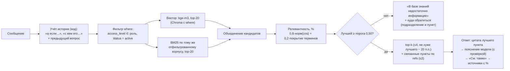

# Поиск и формирование ответов

## Пайплайн

## Оценка релевантности

- `норм(cos) = clip((cos − 0,40) / (0,68 − 0,40), 0, 1)` — косинусная близость bge-m3 переводится в шкалу 0–100 %. Калибровка: у релевантных пунктов cos ≈ 0,58–0,76, у вопросов вне базы ≤ 0,49.
- `покрытие` — доля «веса» (idf) терминов запроса, найденных во фрагменте. Термины, которых нет в базе (например «борщ», «зарплата»), получают максимальный вес и снижают покрытие.
- Если пункт запрошен по номеру («пункт 8.12.4»), он получает 100 %, и показывается только он.
- Все параметры (`cos_low`, `cos_high`, веса, `min_relevance`, `top_k`, `rel_gap`, `expand_refs`) лежат в `config.yaml`.

## Формирование ответа (код, а не модель)

1. **Цитата** лучшего пункта (и второго, если он почти так же релевантен) — дословный текст из базы.
2. **«Простыми словами»** — 1–3 предложения модели **по одному лучшему пункту**. Короткий промпт с одним примером формата, температура 0, данные в разделителях `<фрагменты>`, `<вопрос>`.
3. **Источники** формируются из метаданных чанков: документ, редакция, дата вступления в силу, пункт или приложение, глава, процент релевантности. Полный текст каждого источника открывается в боковой панели. Модель ссылки не пишет.
4. Ответ без источников не выдаётся: либо цитата с источниками, либо отказ.

## Меры против ошибочных ответов

| Риск | Мера |
|---|---|
| Ответ «из головы» при отсутствии данных | Строгий порог релевантности, ниже — отказ и контакт подразделения. Лог вопросов без ответа (`storage/logs/unanswered.jsonl`) |
| Выдуманные пункты, сроки, числа | Ссылки и цитаты формирует код. Пояснение модели отбрасывается, если в нём есть число или номер, которых нет во фрагменте |
| Выдуманные термины и расшифровки (пример из тестов: «Экспорт-контракт (ЭКД)») | Отбрасывается пояснение с новыми словами через дефис, новыми именами с заглавной буквы и расшифровками аббревиатур, которых нет во фрагменте |
| Смешение смысла нескольких пунктов | Пояснение строится только по лучшему пункту, остальные даются цитатой или в «См. также» |
| Неверный «пересказ» | Доля слов пояснения, присутствующих во фрагменте и вопросе, должна быть ≥ 55 %, иначе показывается только текст пункта |
| Угадывание параметров | Если не хватает вида документа или категории, задаётся **один** уточняющий вопрос с кнопками (согласование, сроки, выбор шаблона) |
| Согласующие и сроки | Только из Матрицы и п. 10.3 / 6.6 кодом. LLM в этом не участвует |
| Prompt injection | Данные в разделителях, разделители вычищаются из пользовательского текста, в системном промпте указано не выполнять команды из данных. Ответ модели всё равно проходит проверку |
| Устаревшая редакция | Поиск только по `active`, в каждом источнике указаны редакция и дата |

## Измеренное качество

См. `tests/eval_results.md` и README: ожидаемый пункт в источниках — 33/33 (контрольная выборка 10/10), корректные отказы — 7/7, утечек доступа нет, пояснение модели проходит проверку в 83 % ответов (в остальных показан только текст пункта). Среднее время ответа — 0,33 с.
