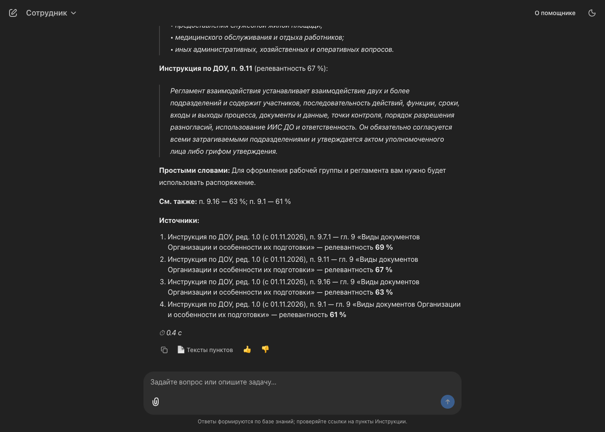
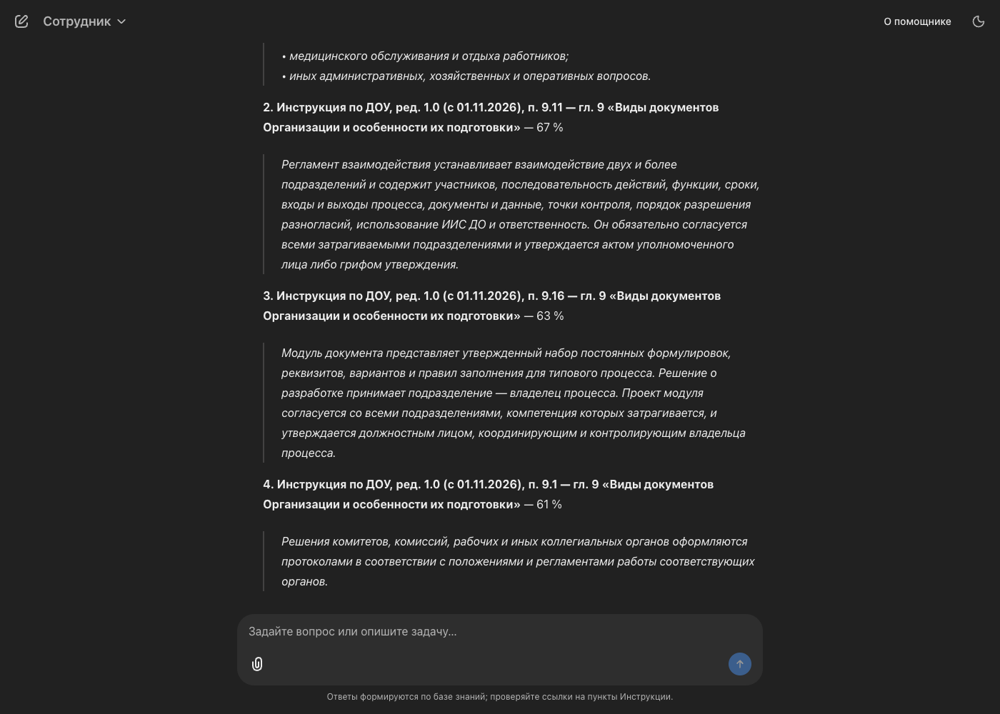
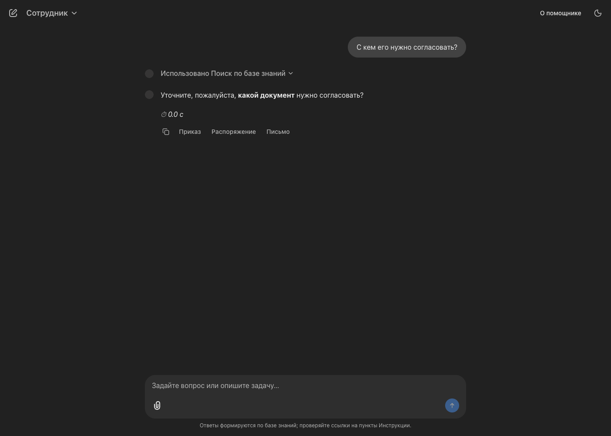
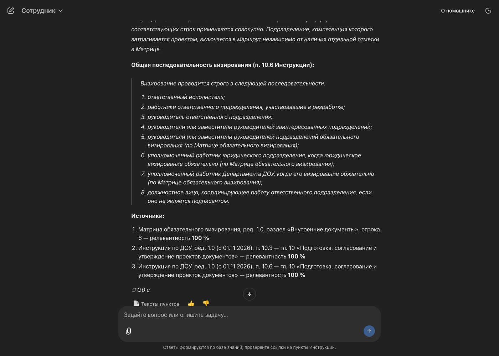
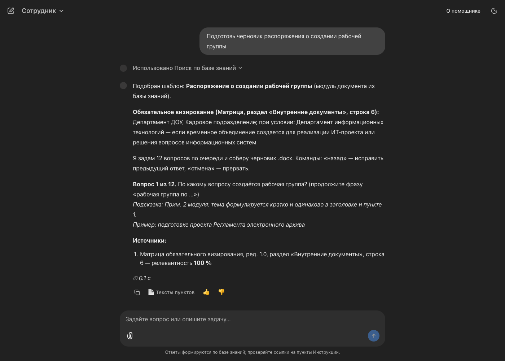
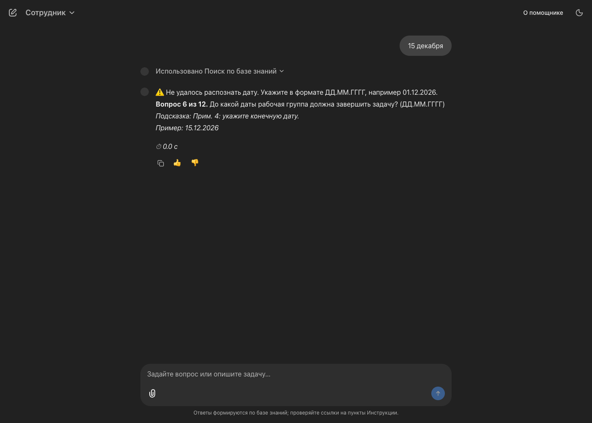
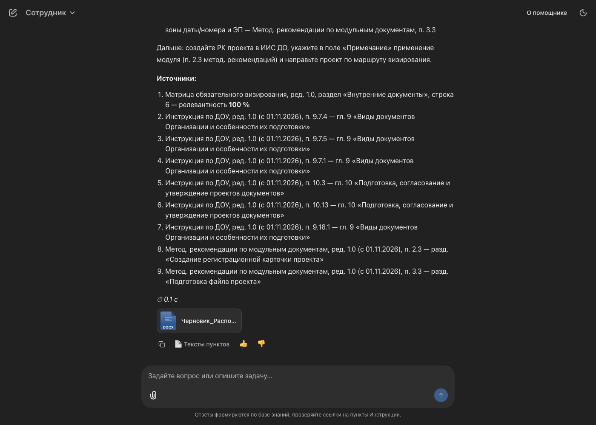
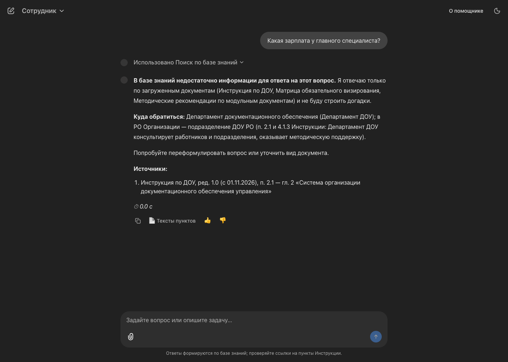
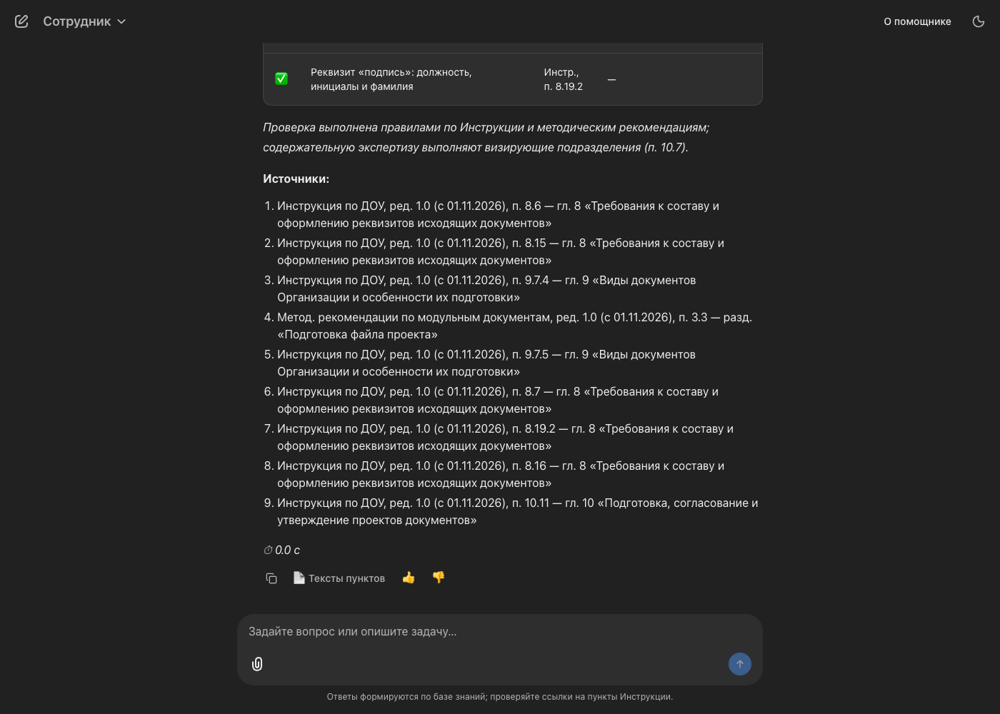
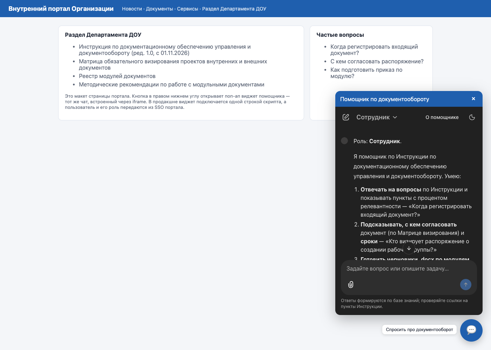

# Интерфейс

Два варианта одного и того же чата:

1. **Отдельный веб-интерфейс** — http://localhost:8000 (Chainlit).
2. **Поп-ап виджет для портала** — макет страницы портала http://localhost:8000/widget: плавающая кнопка в правом нижнем углу открывает окно чата (iframe). В продакшне подключается одной строкой скрипта, а роль передаётся из SSO портала.

Все скриншоты получены автоматически скриптом `tests/ui_demo.py` в Chrome.

## Элементы интерфейса

| Элемент | Назначение |
|---|---|
| Профиль в шапке («Сотрудник ▾») | Выбор роли: Сотрудник / Эксперт ДОУ / Администратор (в продакшне — из SSO) |
| Ответ | Цитата пункта → «Простыми словами» → «См. также» → **Источники** с документом, редакцией, датой, пунктом, главой и **процентом релевантности** |
| Кнопка «📄 Тексты пунктов» | Полные тексты всех источников ответа |
| Кнопки быстрых ответов | Варианты уточняющего вопроса (вид документа, категория по Матрице, шаблон, да/нет, «оставить по умолчанию») |
| «Использовано: Поиск по базе знаний» | Раскрываемый шаг: намерение и число источников |
| Скрепка / drag&drop | Загрузка черновика .docx/.pdf на проверку |
| Карточка .docx | Скачивание сформированного черновика |
| 👍 / 👎 | Обратная связь (`storage/logs/feedback.jsonl`) |
| ⏱ | Время ответа |
| Настройки (только Администратор) | Поиск также в архивных редакциях |

## Скриншоты

| | |
|---|---|
| Стартовый экран: возможности, примеры |  |
| Вопрос своими словами → пункты с % релевантности |  |
| Полные тексты источников по кнопке |  |
| Уточняющий вопрос |  |
| Согласующие по Матрице, срок, порядок визирования |  |
| Подбор шаблона, согласующие, первый вопрос |  |
| Валидация ответа |  |
| Готовый .docx + чек-лист |  |
| Честный отказ + куда обратиться |  |
| Отчёт проверки черновика |  |
| Поп-ап виджет на странице портала |  |

## Макет виджета (схема)

```
┌──────────────── Внутренний портал Организации ────────────────┐
│  Новости · Документы · Сервисы · Раздел Департамента ДОУ      │
│                                                               │
│  ┌ Раздел Департамента ДОУ ──────┐  ┌ Частые вопросы ┐        │
│  │ Инструкция … (ред. 1.0)       │  │ …              │        │
│  └───────────────────────────────┘  └────────────────┘        │
│                                      ┌ Помощник по ДО ──── × ┐│
│                                      │ Сотрудник ▾           ││
│                                      │ …диалог…              ││
│                                      │ [Задайте вопрос…] 📎 ➤││
│                                      └───────────────────────┘│
│                                  [Спросить про документооборот] (💬) │
└───────────────────────────────────────────────────────────────┘
```

На мобильной ширине окно виджета растягивается на всю ширину экрана с отступами 8 px.
